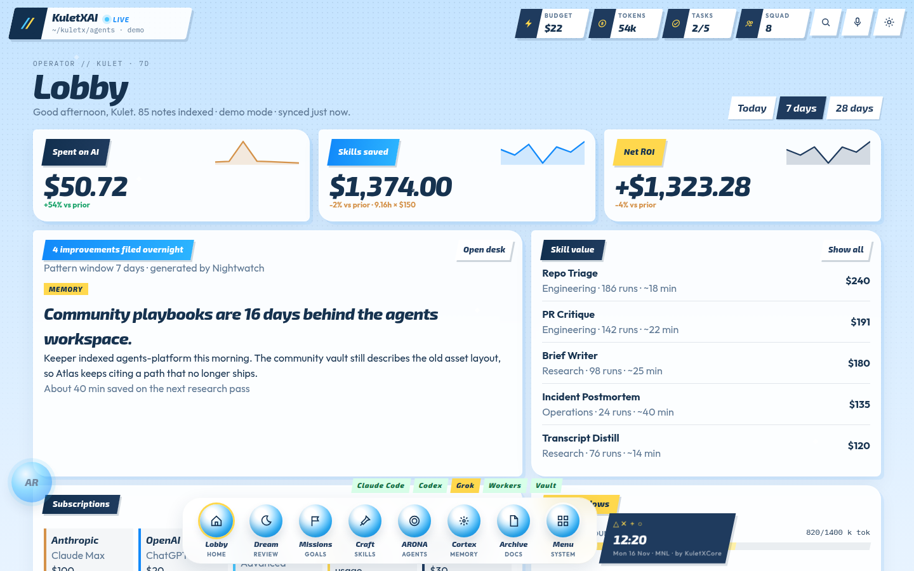
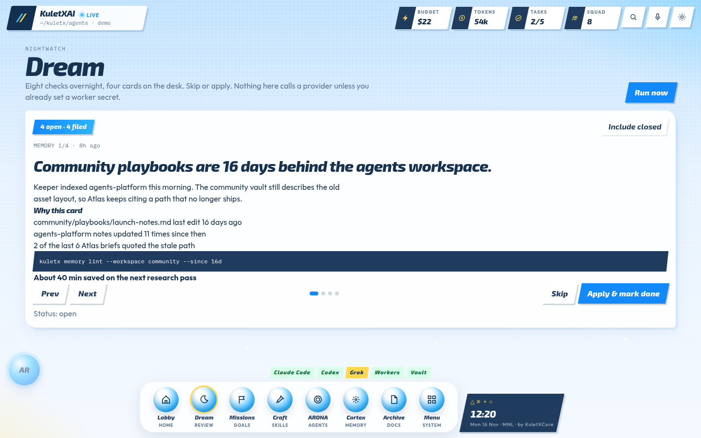
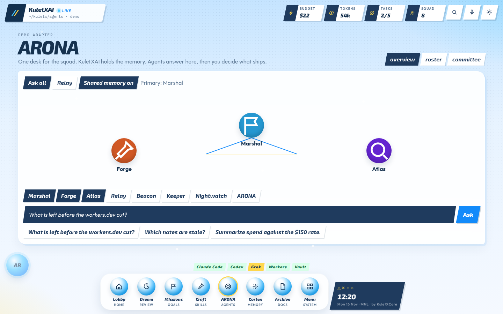
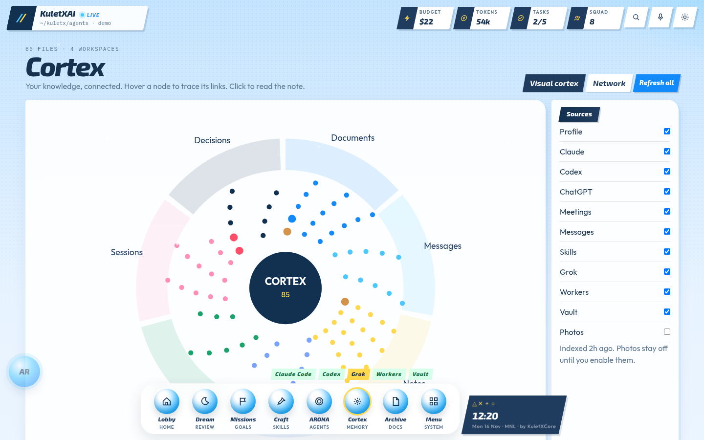

# KuletXAI

KuletXAI is an agent control plane: spend, plan windows, overnight dream cards, a memory cortex, skills priced at an hourly rate, mission handshakes, and a squad you can ask together. The assistant in the console is **ARONA**.

The public demo runs on seeded data. It does not need provider keys. Chat uses a deterministic demo adapter until you set an OpenAI-compatible secret on the worker.

Deploy target: [https://agents.kuletxcore.workers.dev](https://agents.kuletxcore.workers.dev) (worker name `agents`, account subdomain `kuletxcore`).

by KuletXCore

## Scripts

| Script | What it does |
|---|---|
| `npm run dev` | Vite dev server plus the worker (local D1 and KV). |
| `npm run build` | Syncs the schema module and builds the client and worker. |
| `npm run deploy` | Builds, then `wrangler deploy`. |
| `npm run db:migrate:local` | Applies `migrations/` to local D1. Optional — the worker also creates tables. |
| `npm run db:migrate:remote` | Applies `migrations/` to the remote D1 database. |

## Local development

```bash
npm install
npm run dev
```

Open the URL Vite prints (usually `http://localhost:5173`).

On the first `/api/*` request the worker creates the D1 tables if they are missing and loads the demo operator **Kulet** (`kuletx`, Asia/Manila, $150/hr) from `seed/catalog.ts`. You do not need a Cloudflare login for local dev.

Reset local data:

```bash
rm -rf .wrangler
```

Optional model (otherwise every chat stays in demo mode). Copy `.dev.vars.example` to `.dev.vars`. A live call also needs `OPERATOR_TOKEN`. The public site will not spend that key unless Settings has the same token for the current tab:

```bash
LLM_BASE_URL=https://api.openai.com/v1
LLM_API_KEY=sk-...
LLM_MODEL=gpt-4o-mini
OPERATOR_TOKEN=choose-a-long-random-string
```

`.dev.vars` is gitignored. The client never receives the key. If the URL or key is missing, or the call fails, the demo adapter answers.

## Kernel (agent runs)

`worker/kernel/` is the part that makes an agent act instead of answer. A run is a loop: the model picks a tool, the worker executes it, the result goes back to the model, until it gives a final answer.

- `tools.ts` is the tool table. Tools are the only way an agent touches D1. Each is `read` or `write`, and `GRANTS` lists which agent may call which.
- `loop.ts` drives a run. Read tools execute at once. A write tool stops the run in `waiting` until the operator approves or denies that exact call, then the run resumes.
- `model.ts` makes one model turn against an OpenAI-compatible endpoint. With no key (or no operator token) it uses a scripted planner instead: read memory and missions, propose one write, report. The tools, approvals, and trace are the same either way.
- `runs` and `run_steps` (`migrations/0002_kernel.sql`) store the transcript and every step, so a run can be inspected and resumed.

| Route | What it does |
|---|---|
| `GET /api/runs` | Recent runs, plus each agent and its tools. |
| `POST /api/runs` | `{ agentId, goal }`. Starts a run and returns its trace. |
| `GET /api/runs/:id` | One run and its steps. |
| `POST /api/runs/:id/steps/:stepId` | `{ approve }`. Decides a waiting write call. |

The Runs room (Routes → Delegate → Start a run or approve a write) is the UI for this. A run executes inside the request and stops after 8 model turns.

## Agent tooling

`DESIGN.md` is the design direction for UI work. `CLAUDE.md` points coding agents at the antislop skills in `.claude/skills/`, and `.mcp.json` registers the Motion and 21st.dev MCP servers. The 21st server reads its key from `TWENTY_FIRST_API_KEY`.

## D1 and KV

Schema: the files in `migrations/`, applied in name order.

Seed content: `seed/catalog.ts`, imported by `worker/seed.ts`. Dates are computed at seed time. A `meta.seeded` row stops the importer from running twice. If that row is missing, the worker wipes demo tables and seeds again.

`wrangler.jsonc` names the D1 database `kuletxai` and the KV binding `CONFIG` without account-specific ids. `wrangler deploy` (and Cloudflare Workers Builds) creates those resources on the account if they are missing, then you can paste the printed ids back into the config if you want them pinned.

Apply the schema remotely after the first deploy (the worker also creates tables and seeds on the first API request if they are empty):

```bash
npm run db:migrate:remote
```

## Deploy

The worker name is `agents`. On an account whose workers.dev subdomain is `kuletxcore`, the hostname is `https://agents.kuletxcore.workers.dev`.

Log in with a browser:

```bash
npx wrangler login
```

Or use an API token (Account / Workers Scripts edit, D1, and Workers KV):

```bash
export CLOUDFLARE_API_TOKEN=your_token
export CLOUDFLARE_ACCOUNT_ID=your_account_id
```

Then:

```bash
# 1. Apply migrations after the database exists (deploy creates it)
npm run deploy
npm run db:migrate:remote
# 2. Optional secrets
npx wrangler secret put LLM_API_KEY
npx wrangler secret put LLM_BASE_URL
npx wrangler secret put LLM_MODEL
npx wrangler secret put OPERATOR_TOKEN
```

Cron `0 22 * * *` UTC is 06:00 in Asia/Manila. That tick runs Nightwatch (the dream pass).

Workers Builds can leave the build command empty. Preview runs `npx wrangler preview`, which runs the `build.command` in `wrangler.jsonc` (`npm run build`) and then uploads `dist/client`. D1 and KV are created on that deploy when the bindings have no ids yet. If you set a dashboard build command, use `npm run build`.

## Screens









## Rooms

Lobby, Dream, Missions, Runs, Craft (skills), ARONA (agents, ask-all, relay, committee), Cortex (memory), Archive (documents), Map (graphs), Patrol (automations), Links, Log, Inbox, Calendar, Ledger, Settings, and the Briefing wizard.

## Layout

- `src/` Vite + React client
- `worker/` Hono API, seed, demo dialogue, optional model call
- `worker/kernel/` agent run loop, tools, model adapter
- `migrations/` D1 schema
- `seed/catalog.ts` demo operator content

Static assets and `/api/*` are one Worker. D1 is the system of record. KV mirrors operator config.
